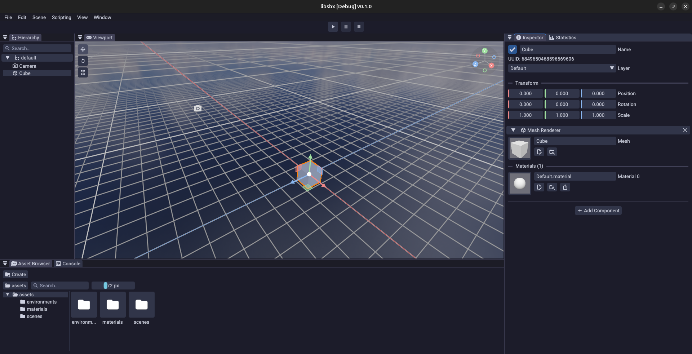
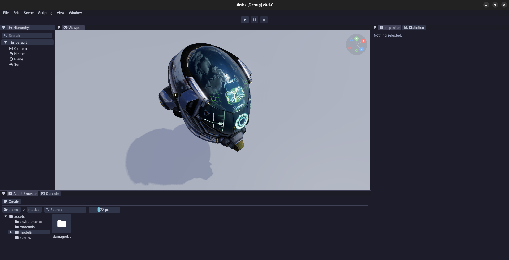
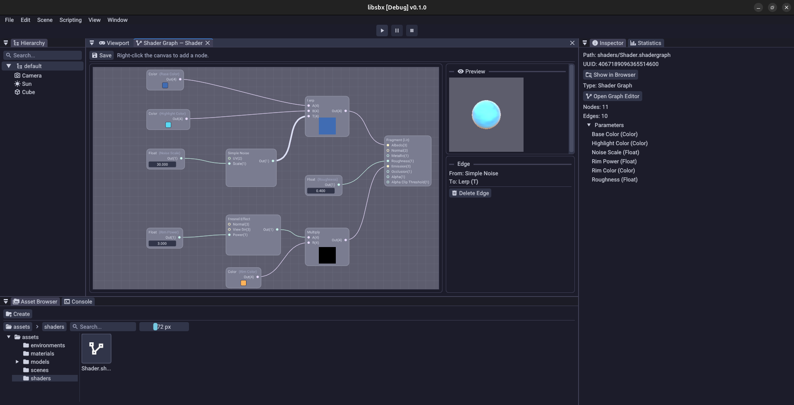
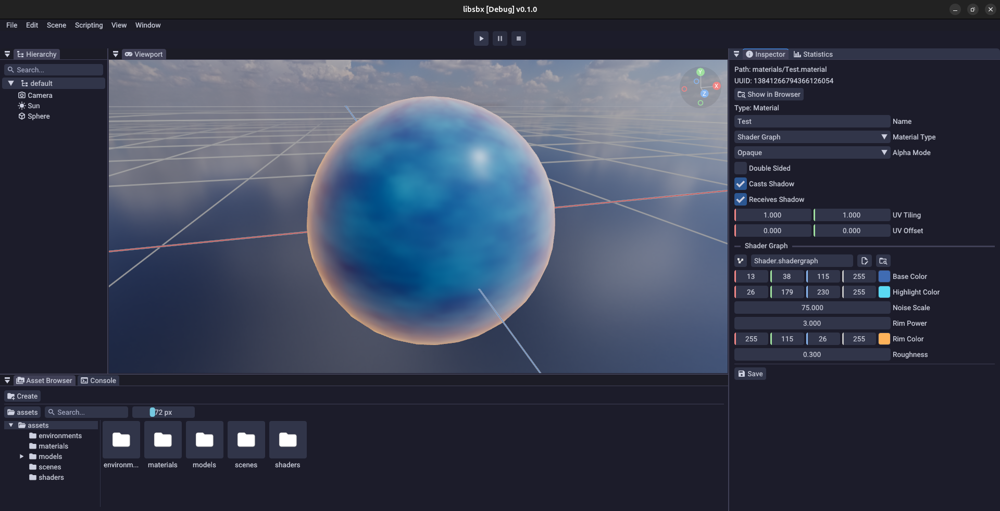

<picture>
  <source media="(prefers-color-scheme: dark)" srcset="images/logo-dark.png" width="400">
  <source media="(prefers-color-scheme: light)" srcset="images/logo-light.png" width="400">
  
</picture>

A modular, Vulkan-based game engine built with modern C++26


Sandbox (`libsbx`) is a game engine written from the ground up in **C++26**. It ships as a single static library plus three applications built on top of it: an in-game **runtime**, a full **editor**, and a **launcher** for picking and starting projects. Scripting is done in C# via a custom .NET host.





## Features

**Rendering**

- Vulkan render graph (dynamic rendering, automatic barriers) with per-pass GPU timings and pipeline statistics
- Physically based shading with clustered light culling and image-based lighting (BRDF LUT, irradiance, prefiltered environment maps)
- Cascaded shadow maps
- GPU frustum culling and a depth pre-pass
- Screen-space ambient occlusion, bloom, and tonemapping
- Weighted blended order-independent transparency
- Anti-aliasing: MSAA (per project) and FXAA (per camera)
- Node-based shader graph that generates Slang shaders, with live node previews
- Skinned meshes with GPU compute skinning, driven by an animation state graph
- GPU particle simulation and rendering (additive and alpha-blended)
- Debug draw, editor grid, and selection outlines
- ImGui-based editor UI, plus a retained-mode canvas UI (SDF text, widgets, screen- and world-space canvases)

**Engine**

- Entity-Component-System core (`ecs`)
- Scene graph with a node/component model and YAML scene serialization
- Scene management: single and additive loading, async loads
- Asset pipeline: import settings, cooking, manifests, residency/streaming, prefabs, built-in primitive meshes
- Physics: GJK/EPA collision, contact solver, raycasts and shape casts, character controller
- Navigation: Recast/Detour-style navmesh baking, pathfinding, and crowd agents (`physics/nav`)
- Audio via OpenAL Soft: clips, 3D sources/listener, nested mixer groups
- Job system: worker pool with work stealing and `parallel_for` (`async`)
- Terrain module with heightmap generation and chunking
- C# scripting via a custom .NET (nethost) integration, with a source-generated interop layer
- Reflection built on C++26 static reflection (`<meta>`), used by the inspector, serializer, and CLI parser
- Cross-platform input, windowing, and process handling (`platform`)
- Tracy profiling integration

| Shader graph editor | Shader graph material in the scene |
|---|---|
|  |  |

<!-- More gallery rows, uncomment as the screenshots are added
|  |  |
|  |  |
-->

## Layout

```
libsbx/     engine library (see module table below)
runtime/    standalone player application
editor/     full scene/asset editor application
launcher/   project picker / launcher application
dotnet/     C# side: Sbx.Managed (native interop), Sbx.Core (user-facing API), Sbx.Compiler
shaders/    Slang shader sources
tests/      GTest unit tests
```

### Engine modules (`libsbx/`)

All modules compile into one `libsbx` static (or shared, via `SBX_BUILD_SHARED`) library target.

| Module | Purpose |
|---|---|
| `assets` | Asset import, cooking, loading, manifests, residency, materials, meshes, prefabs, shader graphs, IBL baking |
| `async` | Job system: worker pool, work-stealing deques, `parallel_for` |
| `audio` | OpenAL Soft audio: clips, sources, listener, mixer groups |
| `canvas` | Retained-mode UI: layout, draw lists, screen/world canvases |
| `cli` | Reflection-driven command-line argument parsing |
| `containers` | Custom containers: dense_map, octree, dynamic_tree, ring/stable/static vector |
| `core` | Engine lifecycle, application base class, module system, project handling |
| `ecs` | Entity-Component-System framework |
| `filesystem` | Virtual filesystem abstraction over disk/archive sources |
| `graphics` | Vulkan device/pipeline/resource layer, render graph primitives, bindless resources |
| `math` | Vectors, matrices, transforms, color, noise, UUIDs |
| `memory` | Allocators, aligned storage, memory tracking |
| `particles` | CPU-side particle spawning/simulation |
| `physics` | Collision (GJK/EPA), contact solving, raycasts/shape casts, character controller, navmesh + crowd navigation |
| `platform` | Windowing, input, process spawning |
| `reflection` | Struct/enum reflection used by the editor and serializer |
| `render` | Render graph, scene renderer and its passes, compositor, shadow/skinning/particle rendering, ImGui backend |
| `scenes` | Scene graph, node/component storage, scene loading/management, YAML scene serialization |
| `scripting` | C# hosting (.NET/nethost), managed object marshalling, script compiler |
| `signals` | Event/signal/connection system |
| `terrain` | Heightmap generation and terrain chunking |
| `units` | Type-safe physical units (length, mass, time, velocity, ...) |
| `utility` | Logging, hashing, compression, timers, general helpers |

### Applications

- **`runtime/`** — minimal executable that boots the engine and runs a project (`runtime --project <path/to/project>`).
- **`editor/`** — ImGui-based editor: viewport with gizmos, hierarchy, inspector, asset browser and import settings, shader graph, animation graph, navigation baking, play mode, prefab editing, undo/redo, project settings, and statistics (`editor/editor/panels/`).
- **`launcher/`** — lightweight project selector that launches the editor or runtime for a chosen project.

## Getting Started

### Prerequisites

- GCC 16+ (needs C++26 static reflection, built with `-freflection`)
- [CMake](https://cmake.org/) 3.25+
- [Conan](https://conan.io/) 2.x
- [Vulkan SDK](https://vulkan.lunarg.com/)
- [Slang](https://github.com/shader-slang/slang) shader compiler
- .NET SDK (net9.0) for the C# scripting side

### Build

```bash
git clone git@github.com:KabelitzJ/sandbox.git
cd sandbox

conan install . --build=missing -s build_type=Debug
cmake --preset x86_64-gcc-debug   # name is <arch>-<compiler>-<build_type>, from CMakeUserPresets.json
cmake --build --preset x86_64-gcc-debug
```

Useful CMake options (all default to `ON` except where noted):

| Option | Purpose |
|---|---|
| `SBX_BUILD_RUNTIME` | Build the runtime executable |
| `SBX_BUILD_EDITOR` | Build the editor executable |
| `SBX_BUILD_LAUNCHER` | Build the launcher executable |
| `SBX_BUILD_TESTS` | Build GTest unit tests |
| `SBX_BUILD_SHARED` | Build `libsbx` as a shared library (default `OFF`) |
| `SBX_ENABLE_PROFILING` | Enable Tracy profiling (default `ON` in Debug) |
| `SBX_TRACK_MEMORY` | Track global new/delete allocation statistics (default `OFF`) |
| `SBX_PREFER_CPU_DEVICE` | Prefer a CPU Vulkan device, e.g. lavapipe (default `OFF`) |

### Entry point

An application lists the modules it needs (dependencies first), builds an engine from them, and runs a class derived from `sbx::core::application`. This is a trimmed version of `runtime/runtime/runtime.cpp`:

```cpp
using module_list = sbx::core::module_list<
  sbx::async::async_module,
  sbx::core::projects_module,
  sbx::platform::platform_module,
  sbx::filesystem::filesystem_module,
  sbx::graphics::graphics_module,
  sbx::render::presentation_module,
  sbx::assets::assets_module,
  sbx::scenes::scenes_module,
  sbx::scripting::scripting_module,
  sbx::render::scene_renderer_module
>;

struct [[=sbx::cli::args]] cli_args {
  [[=sbx::cli::required]]
  [[=sbx::cli::help("path to the project to open")]]
  std::filesystem::path project;
};

auto main(int argc, const char** argv) -> int {
  auto args = std::vector<std::string_view>{argv, argv + argc};
  const auto parsed = sbx::cli::parse_or_exit<cli_args>(args);

  try {
    const auto loaded = sbx::core::project::load(parsed.project);

    auto config = sbx::core::engine_config{
      .threading = sbx::core::threading_policy::multi_threaded,
      .project = sbx::core::project_config{
        .root = parsed.project.parent_path(),
        .name = loaded.name()
      }
    };

    auto engine = sbx::core::basic_engine<module_list>{config};
    engine.run<my::application>();
  } catch (const std::exception& exception) {
    sbx::utility::logger<"core">::error("{}", exception.what());
    return sbx::core::exit::failure;
  }

  return sbx::core::exit::success;
}
```

## Contributing

1. Fork the repository
2. Create a feature branch
3. Make your changes
4. Open a pull request

Found a bug or have a suggestion? [Open an issue](https://github.com/KabelitzJ/sandbox/issues).

## License

This project is licensed under the [MIT License](LICENSE).

## Contact

GitHub: [KabelitzJ](https://github.com/KabelitzJ)
